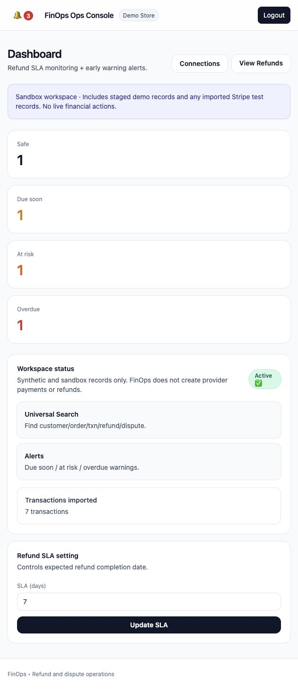
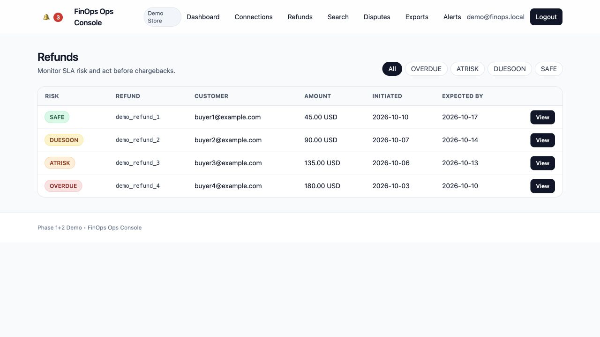
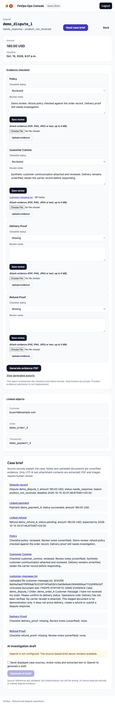
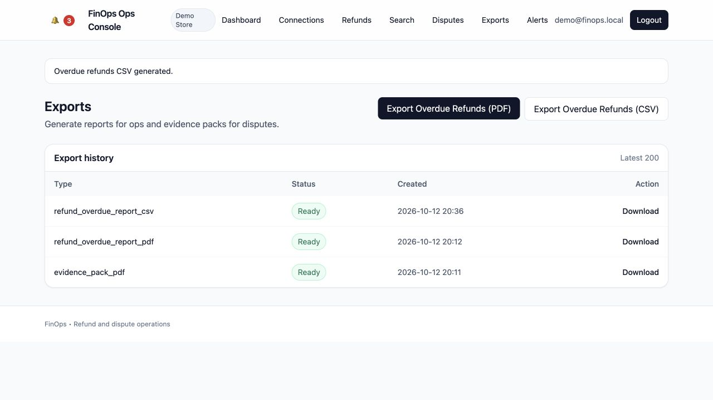
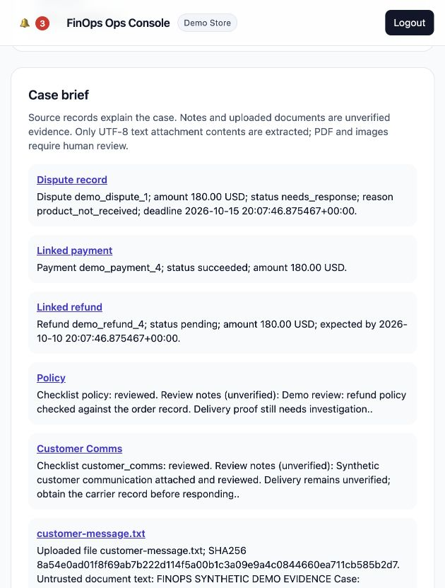
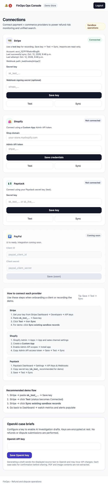

# FinOps

A refund and dispute operations console built by **Donatus Gwer**. It helps a merchant support team spot approaching refund deadlines, find the customer and payment behind a case, review dispute evidence, and export an operations report. Read-only Stripe sandbox synchronization and optional source-linked AI investigation drafts extend the case workflow.

[](https://github.com/Gwerdonatus/FinOps/actions)

A payment provider tells you a refund's status. FinOps adds a workspace-specific operational deadline and a view of which cases need attention. Its risk states describe deadline urgency; they do not predict chargebacks or prove fraud.

## A concrete walkthrough

The local scenario uses **synthetic data** for a fictional store: four pending refunds have different deadlines and one dispute needs a response. No payments, refunds or dispute submissions are made to an external provider.

1. Open the dashboard to see safe, due-soon, at-risk and overdue cases.
2. Filter refunds by urgency and open the linked customer, order and payment.
3. Review alerts and search a customer email to see the complete case context.
4. Open a dispute, attach the supplied synthetic customer-message document, review it, and inspect the linked case brief.
5. Optionally configure OpenAI, confirm source sharing, and generate a draft with exact supporting quotes.
6. Generate an evidence summary PDF.
7. Generate/download the overdue refund report as PDF or CSV.

These screenshots show the running application with labelled synthetic data. The connected sandbox adds three imported test payments; no provider transactions are created by FinOps.













## Deadline logic

```text
expected deadline = refund initiation + workspace SLA days
SAFE       more than 72 hours remaining
DUE_SOON   24 to 72 hours remaining
AT_RISK    0 to 24 hours remaining
OVERDUE    deadline has passed
```

Completed or canceled refunds do not become overdue simply because time passes. The single risk worker recalculates every minute. State transitions generate alerts; repeating a refresh without a state change creates no additional alert. Workspace SLA is an internal operations target, not a provider promise or regulatory deadline.

## Run locally

Docker Compose runs Django/Gunicorn, private PostgreSQL, a risk-refresh worker and a five-minute Stripe synchronization worker. The default interface binds to `127.0.0.1:8300`, leaving the other portfolio projects' ports free.

```bash
cp .env.example .env
# Replace the local password, Django secret and Fernet encryption key.
# Fernet key: python -c "from cryptography.fernet import Fernet; print(Fernet.generate_key().decode())"
docker compose -p finops up --build -d --wait
docker compose -p finops exec web python manage.py seed_demo
```

Open `http://localhost:8300`. Demo login: **demo@finops.local / demo1234**. `DEMO_MODE=1` is required for the local scenario; it is intended for loopback development only. Running `seed_demo` again preserves the original records and review notes.

Migrations and static collection run at app startup. PostgreSQL, private attachments and generated exports use named volumes. Do not remove the volumes to upgrade an existing environment.

## Implemented

- Session authentication and workspace-scoped case reads, review updates and export downloads.
- Admin-only SLA settings; POST/CSRF-protected review and export actions.
- Decimal-safe currency display for USD/EUR/GBP/NGN/JPY; unsupported display currencies explicitly show minor units.
- Refund deadline classification, transition alerts and periodic refresh.
- Cross-entity exact ID/email search.
- Dispute checklist notes and PDF summaries; overdue refund PDF/CSV reports.
- Unique report filenames, persistent export history and encrypted connector credentials.
- Read-only Stripe sandbox payment/refund/dispute imports, preserved timestamps, periodic refresh, signed and deduplicated webhook processing; see [connector scope](SETUP_CONNECTORS.md).
- Private workspace-scoped attachments with size/type limits and SHA256 provenance; text extraction for UTF-8 text documents.
- Source-linked case briefs; optional OpenAI drafts with sharing consent, strict output structure, exact-quote validation, cached results and stale-source warnings.
- Encrypted, admin-configured OpenAI credentials. AI has no payment or submission tools.
- Regression tests, coverage-gated CI and database-aware health verification.

## Honest boundaries

This is a local engineering demo, not a production payment operations deployment. Provider evidence submission is not implemented. PDF/image OCR and malware scanning are not implemented; uploaded files are downloaded as attachments and need human review. Checklist review is an operator's record, not proof of delivery or an automatically validated artifact. Reports are evidence summaries, not compliance certification.

The local demo runs without provider credentials. Read-only synchronization was verified against the existing Stripe sandbox: three payments and no available refunds/disputes. Signed local webhook delivery and deduplication were verified; external Stripe delivery requires a configured endpoint or CLI forwarder. Shopify and Paystack currently have credential/test/list adapters; their records are not fully imported into the operations models. No dispute win prediction or chargeback-prevention claim is made.

Styling currently uses Tailwind's browser CDN and requires Internet access. Production hosting would need compiled assets, HTTPS configuration, credential lifecycle controls, monitored workers and further provider integration hardening.

## Verification

Local verification: **42 passing tests, 75.93% application coverage**, PostgreSQL-backed runtime and repeatable seeding. [Detailed verification](docs/verification.md).

```bash
docker compose -p finops exec web ruff check .
docker compose -p finops exec web black --check .
docker compose -p finops exec web python manage.py check
docker compose -p finops exec web python manage.py makemigrations --check --dry-run
docker compose -p finops exec web pytest --cov=apps --cov-report=term-missing --cov-fail-under=60
docker compose -p finops config --quiet
docker compose -p finops ps
```

Pinned Python dependencies in `requirements.lock` align the local environment and CI. CI checks Python 3.11 and 3.12. No production throughput or chargeback outcome is claimed.

## Optional AI setup

An admin can save an OpenAI API key on **Connections → OpenAI case briefs**. The key is encrypted with the existing Fernet key and never displayed again. `OPENAI_API_KEY` is also supported as an environment fallback; `OPENAI_MODEL` defaults to `gpt-4.1-mini`.

On a dispute, review the displayed source text, confirm sharing, then select **Generate AI draft**. Source notes and extracted text are sent to OpenAI and may incur API charges. No full PDFs/images, customer email fields, provider credentials or raw provider payloads are sent. Notes/documents may themselves contain personal information; review before sharing. `store=false` disables Responses API storage; it is not a claim of zero provider retention.

The default source-based brief works without an API key. Live OpenAI generation is intentionally unconfigured in this environment at the owner's request; mocked API tests verify the integration and failure paths. Citation validation checks exact source quotes, not the semantic truth of every model interpretation. Human review remains necessary.

See [case-workflow design decisions](docs/case-workflow.md) for data boundaries, failure handling and remaining work.
